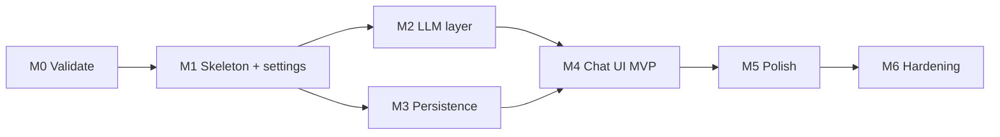

# Plan — Flutter AI chat app

Implements the [design spec](../specs/ai-chat-app.md) for the
[epic](../epics/ai-chat-app.md). Endpoint evidence:
[LiteLLM research](../research/litellm-endpoint.md).

Estimate: **6.5–7.5 dev days** for one developer, Android target. No code has been
written yet. Start only after M0 passes.

## Sequencing

M2 and M3 can run in parallel once M1 lands. M4 is the integration point and uses
`MockLlmClient` first, then the live proxy.

## M0 — Validate assumptions — **done** (0.5 d)

Outcome: all checks passed. Details and numbers are in
[the research page](../research/litellm-endpoint.md#m0-verification-2026-11-19).

1. **Android access:** the emulator (`Medium_Phone`, API 37) resolves
   `llm.lan.otakeessen.com` → `192.168.2.240`, trusts the cert, lists 6 models, and
   streams `llama3.2-3b-cpp`. Boot it with `flutter emulators --launch Medium_Phone`
   (allow several minutes; manual headless launches of this AVD segfaulted). A physical
   device check is still recommended before release.
2. **Streaming/cancel from Dart:** verified with `http` 1.6.0. Closing the client aborts
   the stream but throws `ClientException`, so M2 must map that to `cancelled`.
3. **Errors:** wrong key and unknown model both return HTTP 400 with a LiteLLM `error`
   object; M2 maps by `error.type`, not status code.
4. **Packages:** `gpt_markdown` 1.4.1 (imports `material_ui`, supports streaming
   rendering), `sqflite` 2.4.6, `sqflite_common_ffi` 2.4.7 (host test passed),
   `flutter_secure_storage` 11.2.0, `provider` 6.1.5+1, `http` 1.6.0, `uuid` 4.6.0.
   A debug APK with all plugins built successfully.
5. **Model guidance:** use `llama3.2-3b-cpp` (~0.8 s first token host) and `gemma3-*`
   for development. `qwen3.5-4b-cpp` streams real `reasoning_content` but took ~74 s
   before content; keep it opt-in.
6. Deferred: Linux desktop host. Not needed for v1; revisit if emulator iteration is
   slow.

## M1 — Skeleton, settings, DI — **done** (1 d)

Dependencies (`pubspec.yaml`, pin via lockfile):

- Runtime: `http ^1.6.0`, `provider ^6.1.5`, `sqflite ^2.4.6`, `path`,
  `path_provider`, `shared_preferences`, `flutter_secure_storage ^11.2.0`,
  `uuid ^4.6.0`, `gpt_markdown ^1.4.1` (chosen in M0; imports `material_ui` and supports
  streaming Markdown).
- Dev: `sqflite_common_ffi ^2.4.7` (host tests), existing `flutter_lints`/`flutter_test`.

Work:

1. Create the folder structure from the spec; keep `main.dart` as bootstrap.
2. `app_theme.dart` (Material 3, light/dark/system) and an app shell with a placeholder
   home screen.
3. `SettingsRepository` (prefs for base URL/default model/system prompt/temperature/
   max tokens/theme; secure storage for the key) with sensible defaults:
   base URL `https://llm.lan.otakeessen.com/v1`, model `llama3.2-3b-cpp`, temperature
   `0.7`, max tokens `1024`.
4. `SettingsController` + settings screen with masked key, “Test connection”
   (`GET /v1/models`), theme switch. Wire dependencies with `provider`.
5. Add `INTERNET` permission to the main manifest.

Files: `lib/main.dart`, `lib/app.dart`, `lib/core/app_theme.dart`,
`lib/domain/repositories/settings_repository.dart`,
`lib/data/prefs_settings_repository.dart`, `lib/ui/settings/*`.

Outcome: implemented the layered `lib/` structure, Material 3 light/dark theme, home
placeholder, `SettingsRepository` + `PrefsSettingsRepository` (prefs + secure storage),
`ModelCatalogClient`, `SettingsController`, and `SettingsScreen`. Android app id is
`com.otakeessen.chatui`. Added the release `INTERNET` permission. Verified on the
emulator: settings save, API key is obscured and survives a force-stop/relaunch, and
"Test connection" returns all 6 live models. `flutter analyze` clean; 7 tests pass.

Acceptance: settings persist across restart; test connection reports the live model
count or a readable error; `flutter analyze` clean.

## M2 — LLM layer — **done** (1 d)

Work:

1. `domain/llm/llm_client.dart`: `LlmClient`, `LlmStreamHandle`, `ChatRequest`,
   `ChatStreamEvent` (sealed), `ModelInfo`, `TokenUsage`, `FinishReason`.
2. `core/sse_parser.dart`: byte/line decoder that yields `data` payloads, handles CRLF,
   comments, multiple chunks per line, `[DONE]`.
3. `data/litellm_client.dart`: `GET /models`, `POST /chat/completions` streaming;
   per-request `http.Client` for cancellation. Closing the client throws
   `ClientException` — catch it in the cancel path and emit `cancelled`. Map errors from
   the LiteLLM `error` object (both bad key and bad model are HTTP 400) to `LlmException`.
4. `data/mock_llm_client.dart`: canned stream with configurable delay, reasoning
   delta option, and error injection for tests/demo.
5. Unit tests: SSE parser table tests, client happy path/error/cancel using
   `http.testing.MockClient`, model parsing, reasoning delta, usage chunk.
6. Optional debug screen: send “hi” and print stream events, used only in development.

Files: `lib/domain/llm/*`, `lib/core/sse_parser.dart`, `lib/core/exceptions.dart`,
`lib/data/litellm_client.dart`, `lib/data/mock_llm_client.dart`,
`test/sse_parser_test.dart`, `test/litellm_client_test.dart`.

Outcome: implemented `ChatRole`/`ChatMessage`, the `LlmClient` + cancellable
`LlmStreamHandle` interface, sealed stream events, `LlmException` mapping, `SseParser`,
`ApiUris`, `LiteLlmClient`, `MockLlmClient`, and `LlmClientFactory`. Tests cover SSE
framing, content/reasoning/usage, finish reasons, 400 auth vs unknown-model mapping,
SSE error payloads, malformed streams, cancellation, and model listing. 13 dedicated
tests pass; the live endpoint was already validated in M0.

Acceptance: unit tests pass; a dev screen streams against the live proxy; cancellation
stops network activity and yields a cancelled terminal event (not an error); a wrong key
and an unknown model show distinct, readable messages despite both being HTTP 400.

## M3 — Persistence — **done** (1 d)

Work:

1. `app_database.dart`: open DB, `PRAGMA foreign_keys=ON`, version 1 schema from the
   spec; a migration hook for future versions; `databaseFactory` selection so host tests
   use `sqflite_common_ffi`.
2. `chat_dao.dart`: conversations/messages CRUD, ordered reads, cascade delete,
   `updated_at` touch, transaction for “insert user + assistant placeholder”.
3. `ChatRepository` implementation: create/open/rename/delete conversation, append
   messages, throttled update of a streaming message, finalize, recovery of
   `streaming` rows on startup.
4. Tests on `sqflite_common_ffi`: CRUD, ordering, cascade, recovery, long content.

Files: `lib/data/db/app_database.dart`, `lib/data/db/chat_dao.dart`,
`lib/data/sqflite_chat_repository.dart`,
`lib/domain/repositories/chat_repository.dart`, `test/chat_repository_test.dart`.

Outcome: implemented `AppDatabase` (schema v1, foreign keys, cascade, message index),
`ChatDao`, and `SqfliteChatRepository` (conversations, exchanges, streaming updates,
titles, rename/delete, recovery). `main()` now opens the DB and marks interrupted runs
stopped on launch. Verified on Android: `databases/chat_ui.db` is created. 8 repository
tests plus the full 30-test suite pass.

Acceptance: repository tests pass; reopening the DB preserves conversations and message
order; an interrupted row becomes `stopped` with an error note.

## M4 — Chat UI MVP — **done** (2 d)

Work:

1. `ConversationsController` + drawer/rail: new chat, open, rename, delete, relative
   times.
2. `ChatController`: load conversation, draft, send, cancel, retry/regenerate; stream
   event handling; throttled persistence; single active run globally; expose run state
   for the status row.
3. Chat screen and widgets:
   - `message_bubble` (user/assistant, `GptMarkdown` with `isStreaming` while active,
     copy, reasoning panel, footer),
   - `composer` (auto-grow, send/stop),
   - `run_status` (spinner/label/elapsed, error + retry),
   - `model_selector` (bottom sheet from `/v1/models`, context badge, refresh),
   - `empty_state` (examples + model picker),
   - auto-scroll with “jump to latest”.
4. `context_budget.dart` and integration: override `*-cpp` to 4096, trim oldest turns,
   show the trim notice.
5. Wire `main.dart`: DB init, settings load, factory chooses `LiteLlmClient` or
   `MockLlmClient` (debug/demo flag).
6. Widget tests with `MockLlmClient`: send, status transitions, stop, error/retry, model
   selector, history.

Outcome: implemented `ConversationsController`, `ChatController`, the responsive chat
screen (drawer on phones, side panel on wide screens), message bubbles with streaming
`GptMarkdown`, reasoning panel, composer with send/stop, run status with elapsed time,
model selector, empty state, auto-scroll, retry, and startup history restore. The model
selector sits above the composer rather than in the app bar (D-17); single active run is
enforced (D-18). Verified live on the emulator: `llama3.2-3b-cpp` and `gemma3-1b-cpp`
stream, model switches persist, history survives relaunch, a stopped partial answer is
kept, and usage tokens render. 42 tests passed at the M4 boundary.

Acceptance: end-to-end chat works with the mock and the live proxy; stopping keeps the
partial text; a conversation with >4096 estimated tokens is trimmed and still answers;
no duplicate messages after retry.

## M5 — Polish — **done** (1 d)

- Rename/delete from the app bar and drawer; delete confirmation; empty-state handling.
- Regenerate last answer; copy message; preserve draft per conversation.
- Footer metadata: model, tokens/cost when provided; no fabricated timings.
- Responsive layout (drawer ↔ rail), theme polish, keyboard insets, safe areas.
- Accessibility: semantics labels, 48 dp targets, readable contrast.
- Markdown edge cases: fenced code, long lines, links (open externally only if a URL
  launcher is added — otherwise plain text).

Outcome: added in-memory drafts per conversation, regenerate/retry actions in the app
bar, and the launcher icon set (legacy density PNGs + adaptive icon from
`assets/branding/app_icon.png`, background `#171420`). Rename/delete remain in the
conversation drawer; the redundant app-bar overflow was removed so titles fit (D-19,
D-20). Verified the wide layout at tablet size, added widget coverage for dark mode and
large-text long Markdown (code fences + long lines), and tooltips cover the icon actions.
45 tests pass.

Acceptance: UX checklist from the spec passes on a phone-sized emulator; dark mode
legible; no overflow errors in release-sized text scaling.

## M6 — Hardening, QA, docs — **done** (1 d)

1. Release manifest: `INTERNET` permission present; confirm no cleartext traffic.
2. Manual matrix against live LiteLLM:
   - each model (including `gemma3-4b-cpp` from live `/models`),
   - cold start after a model switch,
   - stop mid-stream, airplane mode mid-stream, 401 with a wrong key,
   - kill the app during a stream → reopen shows `stopped`,
   - long chat (trim notice), rapid conversation switching.
3. Confirm no key/prompt logging in release (`flutter run --release` + logcat).
4. Run `flutter analyze`, `flutter test`, `flutter build apk --release` (debug signing).
5. Update `wiki/pages/project-overview.md` (tech stack/architecture) and
   `wiki/pages/build-deploy.md` (new run/test notes); log the epic outcome.

Outcome: release manifest keeps `INTERNET` and now sets
`android:usesCleartextTraffic="false"`. Live probes succeeded for `llama3.2-3b-cpp`,
`gemma3-1b-cpp`, `gemma3-4b-cpp`, `qwen2.5-coder-3b-cpp`, and `deepseek-chat`
(`qwen3.5-4b-cpp` stays covered by the M0 reasoning/stream test; its ~74 s reasoning
makes it unsuitable for the fast QA loop). Cold start shows the waiting state; stop
keeps the partial reply; killing the app mid-stream and relaunching shows `Stopped`;
history survives restarts. Cleartext is disabled (D-22). Release APK builds, installs, and runs; logcat contained no
API key, prompt, or `Authorization` strings. `flutter analyze` clean; 45 tests pass.
Remaining risk: physical-device LAN/TLS check (emulator verified).

Acceptance: test suite green; release APK builds; manual matrix signed off.

## Definition of done

- All success criteria in the [spec](../specs/ai-chat-app.md) and [epic](../epics/ai-chat-app.md)
  are met.
- `flutter analyze` clean, `flutter test` green, release APK builds.
- No secrets or prompt text in logs; key stored outside plain prefs on Android.
- Wiki updated: overview/build-deploy, tickets for completed milestones, decisions for
  any deviations.

## Risks & mitigations

| Risk | Impact | Mitigation |
|---|---|---|
| Phone cannot reach LAN host (DNS/cert/VPN) | blocker | M0 passed on emulator; still check a physical device; VPN; never use raw IP |
| Cold model load looks frozen (10–60 s) | UX | `Waiting for model…` + elapsed; generous timeouts; hint after 5 s |
| LiteLLM advertises 131k but llama.cpp is 4096 | failed/expensive requests | client override + trimming + notice; test long chat |
| One model, one slot; concurrent sends queue | confusing latency | single active run; stop prompt in other chats |
| DeepSeek costs money | surprise spend | local model default; show cost; no auto-fallback UI confusion |
| Markdown package churn | rework | resolved in M0: `gpt_markdown` 1.4.1 targets `material_ui`; keep rendering in one widget |
| `http` cancellation leaves the stream open | wasted tokens | per-request client + test that close aborts |
| Secure storage unavailable on a dev target | blocked onboarding | Android-first; document fallback for desktop |
| Prompts are traced in Langfuse server-side | privacy expectation | state it in settings/about; LAN-only |

## Ticket breakdown (create on start)

| Slug | Scope |
|---|---|
| `ticket-m0-endpoint-spike` | Device connectivity + package validation — **done** |
| `ticket-m1-app-shell-settings` | Theme, shell, settings, DI |
| `ticket-m2-llm-client` | Interface, SSE parser, LiteLLM + mock clients |
| `ticket-m3-chat-persistence` | sqflite schema, DAO, repository, recovery |
| `ticket-m4-chat-ui` | Chat screen/controllers/status/model selector |
| `ticket-m5-ux-polish` | History actions, markdown, responsive, a11y |
| `ticket-m6-hardening` | QA matrix, release build, docs |
