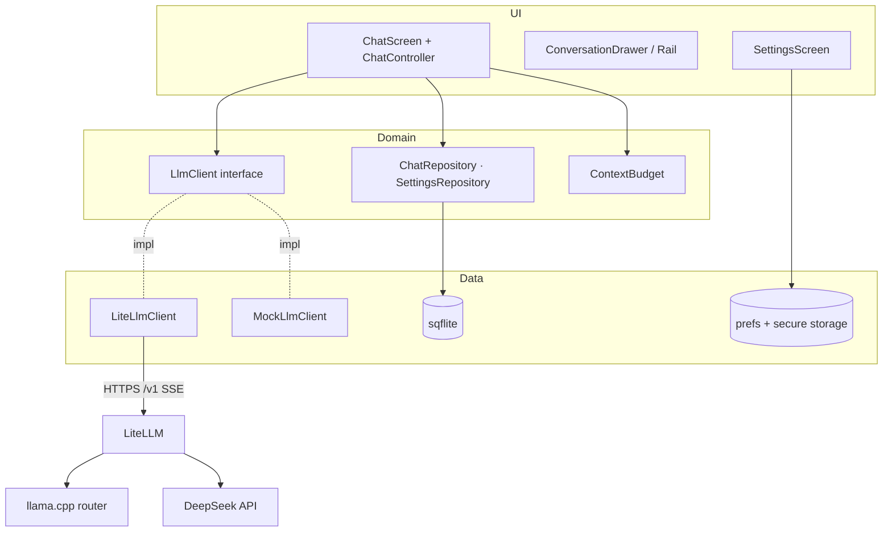

# Spec — AI chat app (Flutter + LiteLLM)

Status: **proposed, design only**. No implementation code exists yet.

- Epic: [ai-chat-app](../epics/ai-chat-app.md)
- Plan: [ai-chat-app](../plans/ai-chat-app.md)
- Endpoint facts: [LiteLLM endpoint](../research/litellm-endpoint.md)

## 1. Goals

1. Chat with the models exposed by the homelab LiteLLM proxy, streaming tokens.
2. Keep a local chat history: many conversations, restore after restart, rename/delete.
3. Select the model per conversation from the live `/v1/models` list.
4. Show an honest run status, including a “thinking/loading” state, and render model
   reasoning only when the model actually emits it.
5. Hide the transport behind an `LlmClient` interface so LiteLLM can be replaced by
   another OpenAI-compatible backend (or a mock) without UI changes.
6. Stay simple: a clean Material 3 chat UI, roughly Open WebUI’s core chat loop, not its
   feature set.

## 2. Non-goals (v1)

- Accounts, auth, multi-user, server-side history sync.
- Tools/function calling, RAG/knowledge, web search, image/file input.
- Background title/tag/follow-up generations.
- iOS/web/desktop releases (Android is the only scaffolded platform).
- Perfect Markdown/LaTeX/code-highlighting; good-enough rendering only.

## 3. Confirmed environment

See [the research page](../research/litellm-endpoint.md) for raw evidence.

- Base URL `https://llm.lan.otakeessen.com/v1`, key `sk-litellm`, OpenAI-compatible.
- SSE streaming with `stream: true` and `stream_options.include_usage: true`.
- Models: `llama3.2-3b-cpp`, `qwen2.5-coder-3b-cpp`, `gemma3-1b-cpp`,
  `gemma3-4b-cpp` (live only), `qwen3.5-4b-cpp`, `deepseek-chat`.
- Local llama.cpp models have a **4096-token** context despite LiteLLM advertising
  32k–262k. One model is resident at a time; model switches cold-start.
- LAN-only: device needs LAN DNS + the wildcard cert (or VPN). Prompts are traced in
  Langfuse by LiteLLM.

**M0 validated (2026-11-19):** end-to-end from Dart on Linux and from a Flutter probe on
the Android emulator (same LAN DNS/TLS path). First-token latency: `llama3.2-3b-cpp`
~0.8 s host / ~5.6 s emulator, `gemma3-1b-cpp` ~2.1 s, `gemma3-4b-cpp` ~4.2 s.
`qwen3.5-4b-cpp` is a reasoning model, streams `reasoning_content`, and needed ~74 s
before its first content token — use `llama3.2`/`gemma3` for development and tests, and
keep `qwen3.5` opt-in. See the [research page](../research/litellm-endpoint.md#m0-verification-2026-11-19).

## 4. User stories

- **New chat:** open app → tap New chat → pick a model → type → send → tokens stream in.
- **Thinking/waiting:** after send I see `Connecting…`, then `Loading model… (12s)` on a
  cold start, then `Thinking…` if reasoning arrives, then `Streaming…`.
- **Stop:** I can stop mid-answer; the partial answer is kept and marked “Stopped”.
- **History:** I can reopen, rename, or delete a conversation; it is still there after an
  app restart; an interrupted stream is shown as interrupted, not lost.
- **Model switch:** I can change the model for a conversation; old messages keep the
  model id they were generated with.
- **Failure:** I see the LiteLLM error message and can retry without retyping.
- **Context:** on a long chat I’m warned that old messages were trimmed to fit 4096
  tokens; the request still succeeds.

## 5. Architecture



Layering rule: UI never touches `http`, SQL, or preferences directly; it talks to a
controller, which talks to `LlmClient` and repositories.

### Folder layout

```text
lib/
├── main.dart                     # bootstrap: DB, settings, dependencies, runApp
├── app.dart                      # MaterialApp, theme, root screen
├── core/
│   ├── app_theme.dart            # Material 3 light/dark, seed colour
│   ├── exceptions.dart           # LlmException + user-facing messages
│   ├── sse_parser.dart           # pure-Dart SSE line parser (unit-tested)
│   └── context_budget.dart       # token estimate + trimming
├── domain/
│   ├── entities/
│   │   ├── conversation.dart
│   │   ├── message.dart          # content, reasoning, run status, usage
│   │   ├── model_info.dart
│   │   └── chat_options.dart
│   ├── llm/
│   │   ├── llm_client.dart       # abstract interface + factory contract
│   │   └── chat_stream_event.dart
│   └── repositories/
│       ├── chat_repository.dart
│       └── settings_repository.dart
├── data/
│   ├── db/
│   │   ├── app_database.dart     # open + migrations
│   │   └── chat_dao.dart
│   ├── litellm_client.dart       # OpenAI-compatible SSE client
│   ├── mock_llm_client.dart      # deterministic stream for tests/demo
│   ├── sqflite_chat_repository.dart
│   └── prefs_settings_repository.dart
└── ui/
    ├── chat/
    │   ├── chat_screen.dart
    │   ├── chat_controller.dart
    │   └── widgets/ (message_bubble, composer, run_status, reasoning_panel,
    │                 model_selector, empty_state)
    ├── conversations/ (drawer/rail, controller)
    └── settings/ (screen, controller)
```

Add `test/` mirrors: `sse_parser_test.dart`, `context_budget_test.dart`,
`litellm_client_test.dart`, `chat_repository_test.dart`, `chat_screen_test.dart`.

## 6. Connector interface

```dart
abstract interface class LlmClient {
  Future<List<ModelInfo>> listModels();
  LlmStreamHandle streamChat(ChatRequest request);
  Future<void> dispose();
}

abstract interface class LlmStreamHandle {
  Stream<ChatStreamEvent> get events;
  Future<void> cancel();
}

sealed class ChatStreamEvent {}
final class StreamOpened   extends ChatStreamEvent {}
final class ContentDelta   extends ChatStreamEvent { final String text; }
final class ReasoningDelta extends ChatStreamEvent { final String text; }
final class UsageReported  extends ChatStreamEvent { final TokenUsage usage; }
final class StreamFinished extends ChatStreamEvent { final FinishReason reason; }
final class StreamFailed   extends ChatStreamEvent { final LlmException error; }

class ChatRequest {
  final String model;
  final List<ChatMessage> messages;   // role + content only, completed turns
  final double? temperature;
  final int? maxTokens;
  final String? systemPrompt;
}
```

- `LiteLlmClient` implements it with `http`; it is OpenAI-compatible, so pointing the
  base URL at OpenAI/Ollama/vLLM works with the same class.
- An `LlmClientFactory` (selected in `main`) allows adding e.g. `AnthropicClient` later
  as a new class + config case; the UI depends only on the interface.
- `MockLlmClient` streams a canned reply with delays; used by widget tests and a demo
  mode when the LAN is unreachable.
- Failures are typed (`LlmException`: network, timeout, unauthorized, modelNotFound,
  rateLimit, server, protocol, cancelled) and mapped to short user messages.

## 7. HTTP / API contract

**List models** — `GET /v1/models`, header `Authorization: Bearer <key>`.
Parse `data[].id`; keep `max_input_tokens` for display only. Cache for the session;
refresh on demand and on settings change. Fall back to a static list if the request
fails.

**Chat** — `POST /v1/chat/completions`:

```json
{
  "model": "llama3.2-3b-cpp",
  "messages": [
    {"role": "system", "content": "..."},
    {"role": "user", "content": "hi"}
  ],
  "stream": true,
  "stream_options": {"include_usage": true},
  "temperature": 0.7,
  "max_tokens": 1024
}
```

Headers: `Authorization`, `Content-Type: application/json`,
`Accept: text/event-stream`.

Parsing rules:

- Decode UTF-8, split lines, handle CRLF. Read only `data:` payloads; ignore blank lines
  and `:` comments.
- `[DONE]` ends the stream. A `finish_reason` also ends it.
- Append `choices[0].delta.content`; append `delta.reasoning_content` (or
  `delta.provider_specific_fields.reasoning_content`) to the reasoning buffer.
- Usage comes in a final chunk when requested; store tokens/cost when present.
- Malformed JSON: skip and log in debug, but fail the run if an explicit
  `{"error": {...}}` payload arrives or the stream closes without content.
- Non-2xx before streaming: parse the LiteLLM `error` object. Do not rely on status
  codes: a wrong key and an unknown model both return **400** (`no_db_connection` vs
  `invalid_request_error`). Map 400 + `invalid_request_error` to “unknown model/request”,
  400 + `no_db_connection`/auth text to “check API key”, 429 to rate limit, 5xx to server.
  Always show the server’s message.
- Timeouts: 15 s connect; **no short read timeout** while streaming (model cold starts
  can take tens of seconds). Show elapsed time in the UI instead.
- Cancellation: each request uses its own `http.Client`; `cancel()` closes it, emits
  `StreamFinished(cancelled)`, and persists the partial answer. Closing the client makes
  the stream reader throw `ClientException: Connection closed while receiving data`;
  the client must translate that into `cancelled`, not surface it as an error.
- Retries: models fetch may retry once; chat is never auto-retried (avoid duplicate
  generations). “Regenerate” is an explicit user action.

## 8. Data model

SQLite via `sqflite` (Android), `sqflite_common_ffi` for tests/desktop.

```sql
CREATE TABLE conversations (
  id            TEXT PRIMARY KEY,
  title         TEXT NOT NULL,
  model_id      TEXT NOT NULL,
  system_prompt TEXT,
  created_at    INTEGER NOT NULL,
  updated_at    INTEGER NOT NULL
);

CREATE TABLE messages (
  id                TEXT PRIMARY KEY,
  conversation_id   TEXT NOT NULL REFERENCES conversations(id) ON DELETE CASCADE,
  seq               INTEGER NOT NULL,
  role              TEXT NOT NULL,          -- user | assistant | system
  content           TEXT NOT NULL DEFAULT '',
  reasoning         TEXT,
  status            TEXT NOT NULL,          -- complete | streaming | stopped | error
  error             TEXT,
  model_id          TEXT,
  prompt_tokens     INTEGER,
  completion_tokens INTEGER,
  cost              REAL,
  created_at        INTEGER NOT NULL
);
CREATE INDEX idx_messages_conv ON messages(conversation_id, seq);
```

Rules:

- Insert the user message and an assistant placeholder before the request; update the
  placeholder (throttled, ~every 300 ms) and flush on finish/stop/error.
- On startup, any `streaming` message becomes `stopped` with an “interrupted” note.
- Deleting a conversation cascades; `PRAGMA foreign_keys = ON`.
- Only completed user/assistant `content` is sent upstream; reasoning, errors, and
  cancelled empty replies are excluded.
- Title = first user message, trimmed to ~40 chars, no extra LLM call.
- `model_id` is stored per assistant message for provenance; the conversation’s
  `model_id` is the default for the next send.
- No export/import or backup in v1.

## 9. Context budget (critical)

LiteLLM advertises 131k for `llama3.2-3b-cpp`, but llama.cpp pins 4096. Without a
client-side budget, long chats fail or silently fall back to DeepSeek (which costs
money).

- Context overrides: all `*-cpp` models → 4096; `deepseek-chat` → 32768 (conservative).
- Estimate tokens with `ceil(chars / 4)` (document the approximation).
- Budget = context − `max_tokens` − ~200 for the system prompt.
- Always keep the system prompt and the newest user message; drop oldest turns until
  the estimate fits. Show a one-line notice in the assistant bubble:
  “Earlier messages were trimmed to fit this model’s 4096-token context.”
- Default `max_tokens` 1024 (setting), which leaves room for conversation history.
- Do not send `reasoning` back as history.

## 10. UI design

Material 3 via the existing `material_ui` package. Seed colour `deepPurple`; light,
dark, and system themes.

**Shell**

- Phone: `Scaffold` + `Drawer` with conversation list.
- Wide (tablet/desktop): `NavigationRail` + chat pane.
- App bar: conversation title (tap to rename), model chip (opens selector), overflow
  (rename, delete, settings).

**Chat screen**

- Message list: user bubbles right-aligned; assistant messages left/full-width with
  Markdown (code blocks, lists, tables, inline code) and a copy action. Render with
  `GptMarkdown(text, isStreaming: isActive, ...)` rebuilt from the accumulated text —
  it reuses settled blocks while streaming and already targets `material_ui`.
- Reasoning panel: collapsible, above the answer, streams when `reasoning_content`
  arrives, auto-collapses once content starts. Hidden entirely if no reasoning.
- Run status row: spinner + text + elapsed. Sequence:
  `Connecting…` → `Waiting for model…` (after ~2 s, with seconds) → `Thinking…`
  (reasoning deltas) → `Streaming…`. Terminal: `Stopped`, `Failed — Retry`.
- Footer per assistant message (muted): model id, tokens (if returned), cost for paid
  models, optional tok/s if available. No fake numbers.
- Composer: auto-growing 1–5 lines, send button; while running it becomes Stop.
  Enter inserts a newline; send via button (avoid accidental sends).
- Auto-scroll while pinned to bottom; if the user scrolls up, pause and show a
  “Jump to latest” button.
- Empty state: model selector, greeting, 3 example prompts.
- Error card inline in the assistant bubble, preserving the user’s message and the
  partial answer.

**Conversation list**

- New chat button, list sorted by `updated_at` desc, title + relative time + model.
- Rename and delete (confirmation). No search in v1.

**Model selector**

- Bottom sheet listing live models with id and a context badge (e.g. “4k context”,
  “cloud”). Selecting updates the conversation default and the chip. A “Refresh”
  action refetches `/v1/models`.

**Settings**

- Base URL, API key (obscured), default model, system prompt, temperature, max tokens,
  theme mode.
- “Test connection” → `GET /v1/models`, shows success + model count or the error.
- “About” with app version. “Clear all conversations” behind a confirmation.

## 11. State & dependency injection

- `provider` package; `ChangeNotifier` controllers; repositories and `LlmClient`
  provided at the root and overridable in widget tests.
- `SettingsController`: loads/saves settings; rebuilds the `LlmClient` when base URL or
  key changes; exposes model list refresh.
- `ConversationsController`: list, create, rename, delete, open.
- `ChatController`: owns the active conversation, draft, messages, run state, and
  persistence. Single active run at a time (llama.cpp has one slot); other chats show
  “Stop the current generation first”.
- Controllers never format UI strings beyond simple labels; widgets own presentation.

## 12. Security & networking

- Add `<uses-permission android:name="android.permission.INTERNET"/>` to the **main**
  manifest (currently only the debug manifest has it) for release builds.
- HTTPS only; LAN cert + DNS required. Document VPN for off-LAN. No cleartext config.
- API key in `flutter_secure_storage`; non-secret settings in `shared_preferences`.
  The key is never logged and is masked in the UI.
- No prompts/responses in logs in release; debug logs go through a single logger that
  is disabled by default.
- Note in the UI/readme that LiteLLM traces calls in Langfuse on the server.

## 13. Testing

- **Unit:** SSE parser (chunk splitting, CRLF, comments, malformed JSON, `[DONE]`,
  error payload); DTO parsing (content, reasoning, usage, finish reason); context
  budget; title truncation; error mapping.
- **Client:** `LiteLlmClient` against `package:http/testing` `MockClient` streams:
  happy path, mid-stream error, non-2xx, cancellation.
- **Persistence:** DAO/repository on `sqflite_common_ffi`: CRUD, ordering, cascade,
  interrupted-run recovery, migration.
- **Widget:** `MockLlmClient` drives chat screen tests: send → user + assistant bubbles,
  status transitions, stop, error + retry, model selector, history drawer, settings.
- **Manual:** live LiteLLM on device for every model, cold start, stop mid-stream,
  airplane mode, app kill during stream, very long chat (trim notice), 401.

## 14. Decisions

Recorded in [decisions.md](../../decisions.md): D-01 connector interface, D-02 local
SQLite history, D-03 `provider` controllers, D-04 `http` SSE client, D-05 independent
4096 context budget, D-06 per-message model provenance, D-07 local titles, D-08 honest
thinking state, D-09 key storage split, D-10 Android-first, D-11 `gpt_markdown`
streaming, D-12 fast default model, D-13 explicit cancellation/400 error mapping.

## 15. Open questions

Defaults are chosen above so implementation can start; flag if any should change.

1. Android only for v1, or also add the Linux desktop host for faster iteration?
   (Secure storage on Linux needs libsecret/keyring.)
2. Is any chat export/backup needed, or is local-only sufficient?
3. Allow multiple conversations to generate concurrently? (Default: no.)
4. `qwen3.5-4b-cpp` already emits `delta.reasoning_content` and is supported. If
   `deepseek-reasoner` is added later, verify its shape; it is not in the current config.
5. Is tool calling required soon, or explicitly post-MVP?
